

  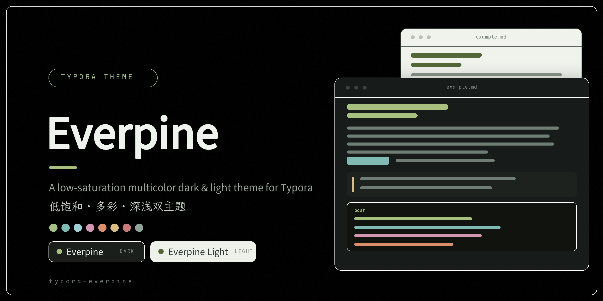

  
  
  

## 简介

Everpine 是一套低饱和多彩的 Typora 主题，包含深色 Everpine 与浅色 Everpine Light 两套外观。两套主题共用同一套设计语言与色相体系，浅色版按同一规则逐色重新校准了对比度，不是简单的反色处理。

正文每个层级一种颜色：一级标题亮绿，二级以下绿、青、紫、橙、灰绿逐级变淡；加粗暖黄、行内代码泡沫青、表头蓝、告警框五色分型。

窗口整体由一组卡片组成：目录卡、正文卡、代码块、表格、引用块与图片各占一档底色，统一使用细线描边、分层阴影与 150ms 动效。

主题对 Typora 的界面做了完整重绘：菜单页、偏好设置、查找替换、弹窗、文件树与滚动条均已适配。

建议搭配 [typora_plugin](https://github.com/obgnail/typora_plugin) 插件使用。

## 字体

主题内置三款字体，按用途分三类，全部随仓库附带，无需手动安装：

| 类别 | 字体 | 应用位置 |
|:---|:---|:---|
| 正文 | [Source Han Sans SC（思源黑体）](https://github.com/adobe-fonts/source-han-sans) | 标题、段落、列表、表格、引用与左侧大纲 |
| 代码 | [Maple Mono NL NF Mono CN](https://github.com/subframe7536/maple-font) | 代码块、行内代码、键帽 |
| 界面 | [LXGW WenKai（霞鹜文楷）](https://github.com/lxgw/LxgwWenKai) | 菜单、标题栏、窗口标签、文件树、偏好设置与正文目录标签 |

## 安装方法

> - 建议 Typora 1.8 及以上版本，告警框（GitHub Style Alert）语法自 1.8 起支持，低版本中告警框按普通引用块渲染；
> - 主题在 Windows 下开发调试，macOS 与 Linux 未做完整测试。

1. 打开主题文件夹：Typora 菜单栏选择 「文件」 → 「偏好设置」 → 「外观」 → 「打开主题文件夹」；
2. 复制 `everpine.css`、`everpine-light.css` 与 `fonts` 文件夹到该目录，三者必须保持同级；
3. 重启 Typora，菜单栏选择 「主题」 → 「Everpine」 或 「Everpine Light」。

Typora 主题文件夹的默认路径：

- Windows：`C:\Users\<用户名>\AppData\Roaming\Typora\themes`
- macOS：`~/Library/Application Support/abnerworks.Typora/themes`
- Linux：`~/.config/Typora/themes`

## 自定义

主题的可调参数集中在 `everpine.css` 与 `everpine-light.css` 开头的 `:root` 区块，两个文件结构相同，可分别调整；修改变量并保存后重新打开文档即可生效：

| 变量组 | 控制内容 |
|:---|:---|
| `--ep-font-body` / `--ep-font-code` / `--ep-font-ui` | 正文、代码、界面三类字体 |
| `--ep-bg-*` | 各表面底色：窗口、侧栏、正文卡、抬升面、引用、代码块、浮层 |
| `--ep-text-*`、`--ep-comment` | 正文、次级、弱化三级文字色与代码注释色 |
| `--ep-green` 等 13 个强调色 | 标题层级色、加粗、行内代码、告警框、列表符号等 |
| `--ep-line-1` ～ `--ep-line-4` | 四档细线边框 |
| `--ep-radius-*` | 五档圆角：卡片、代码块、块级元素、行内 chip、提示 |
| `--ep-shadow-*` | 卡片、块级、浮层、图片四组阴影 |
| `--ep-speed`、`--ep-ease` | 全局动效时长与缓动曲线 |

## 成品截图

### 深色 Everpine

#### 目录与正文

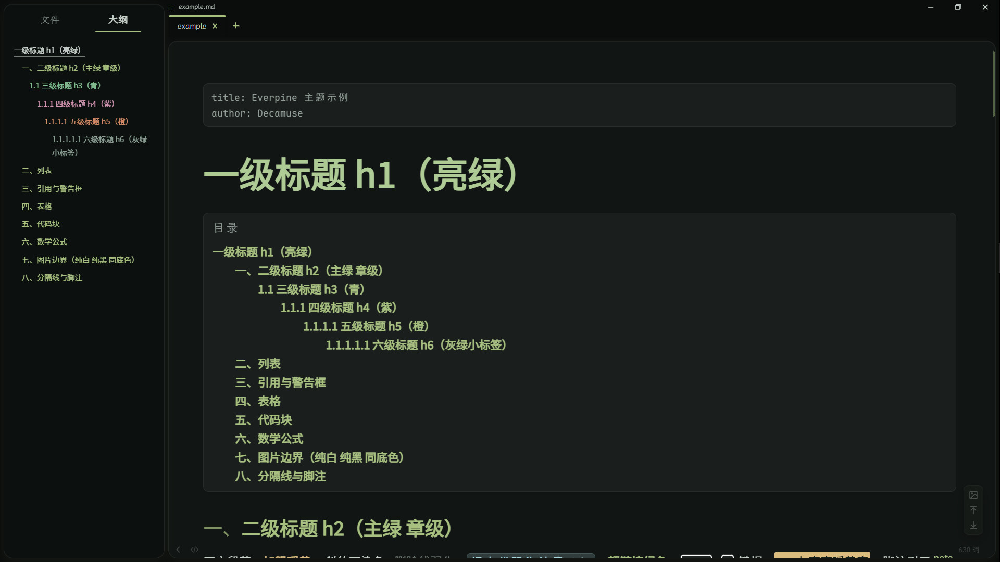

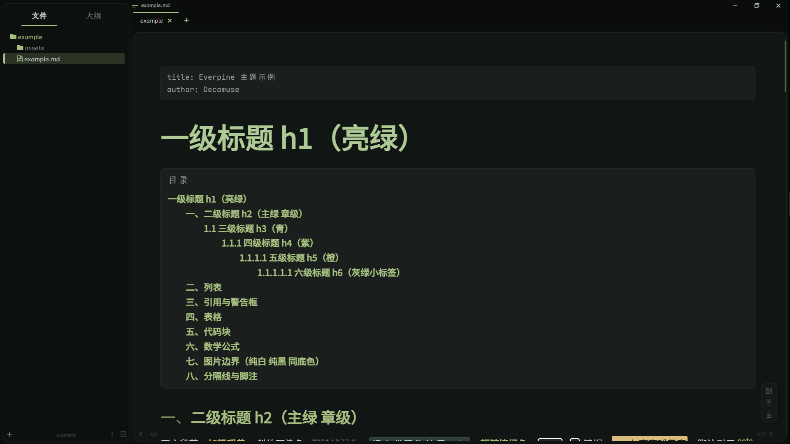

#### 引用与告警框

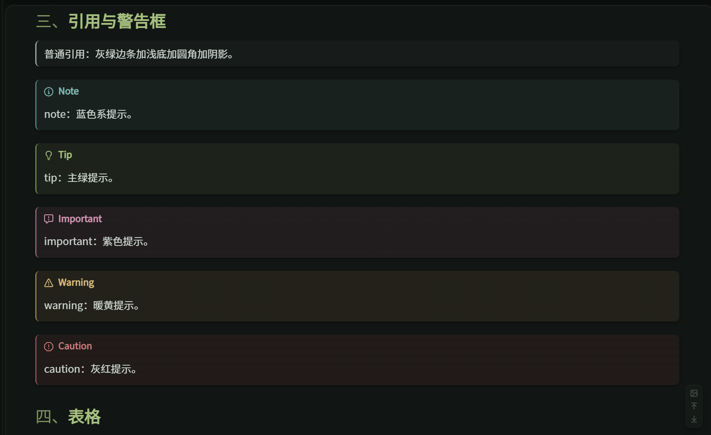

#### 表格

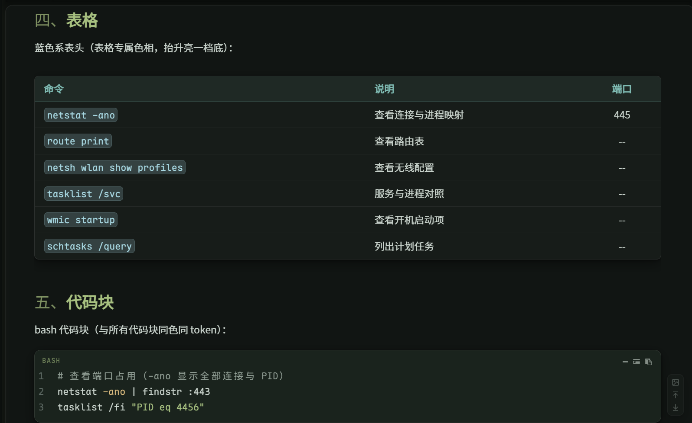

#### 代码块

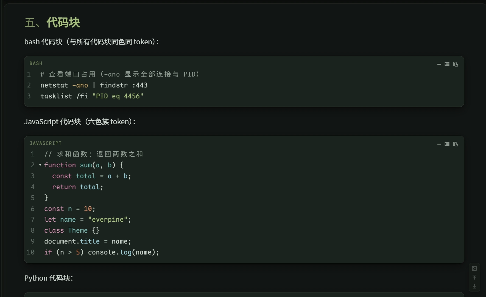

#### 数学公式

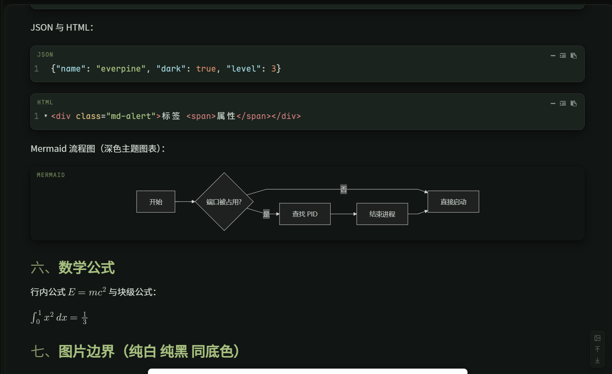

#### 偏好设置

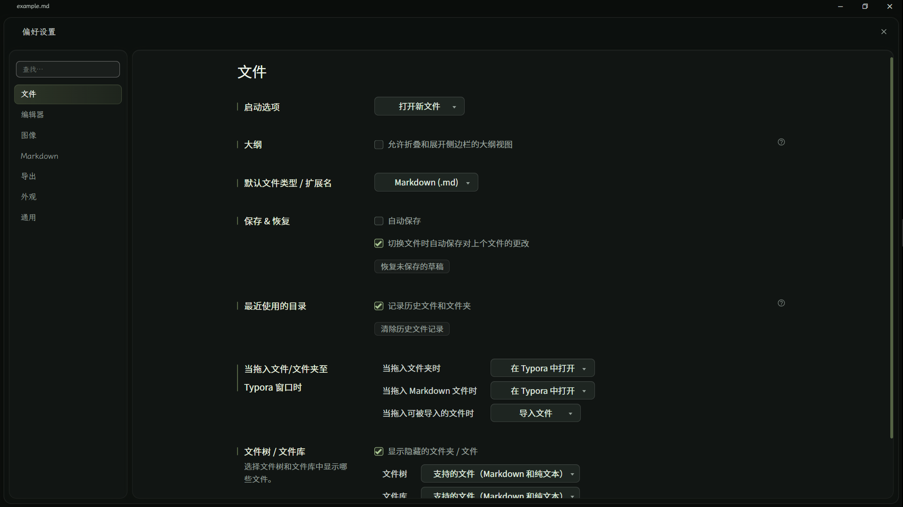

#### 菜单页

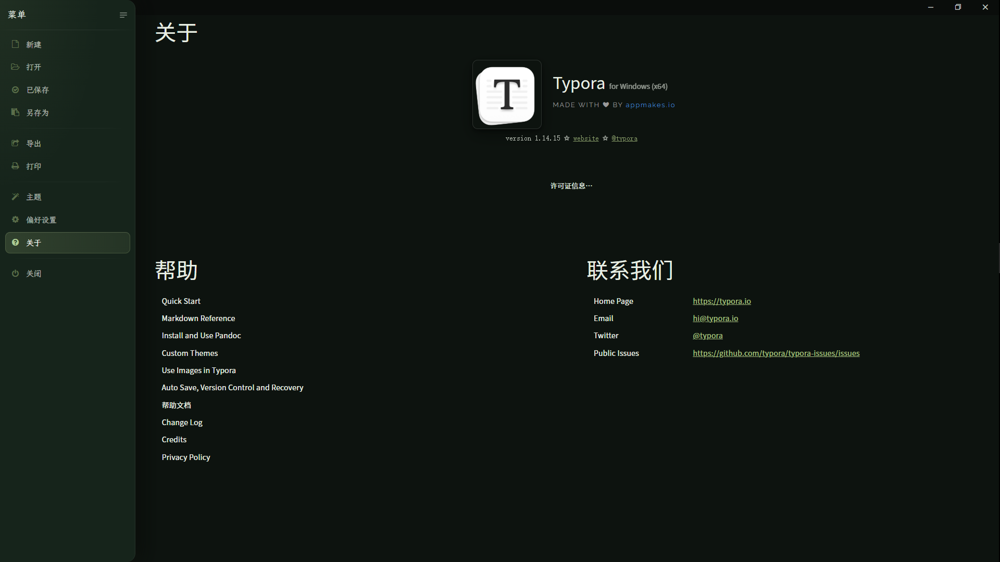

### 浅色 Everpine Light

#### 文件树与正文

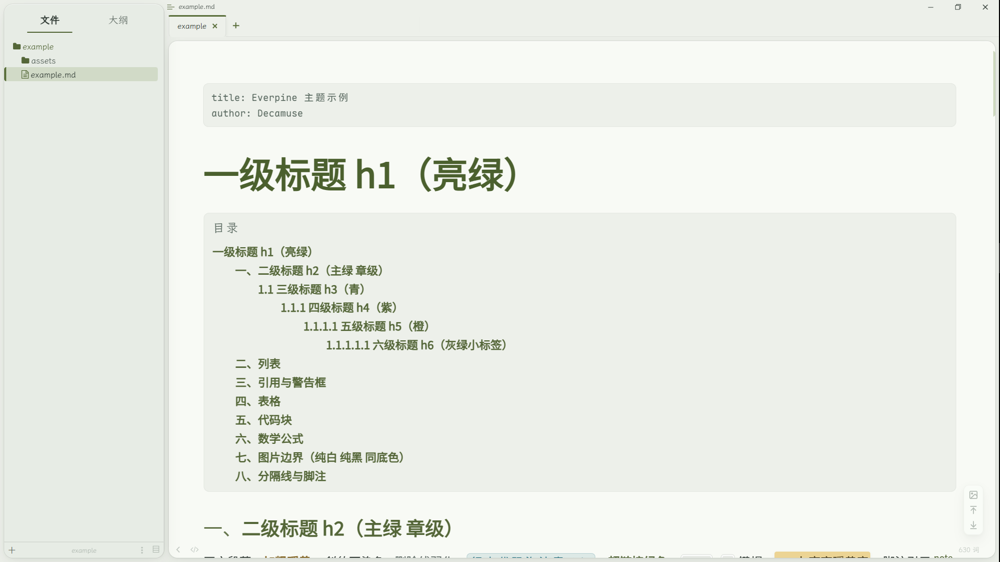

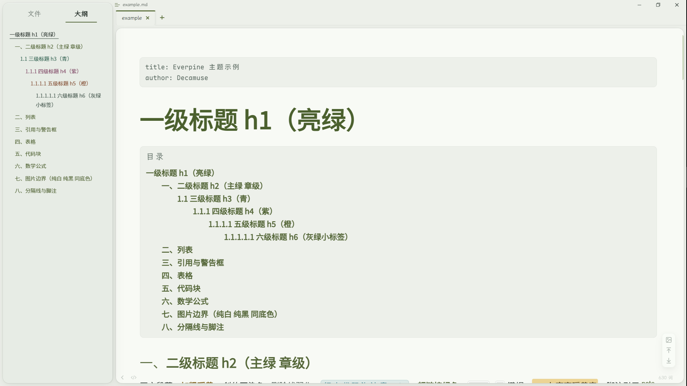

#### 引用与告警框

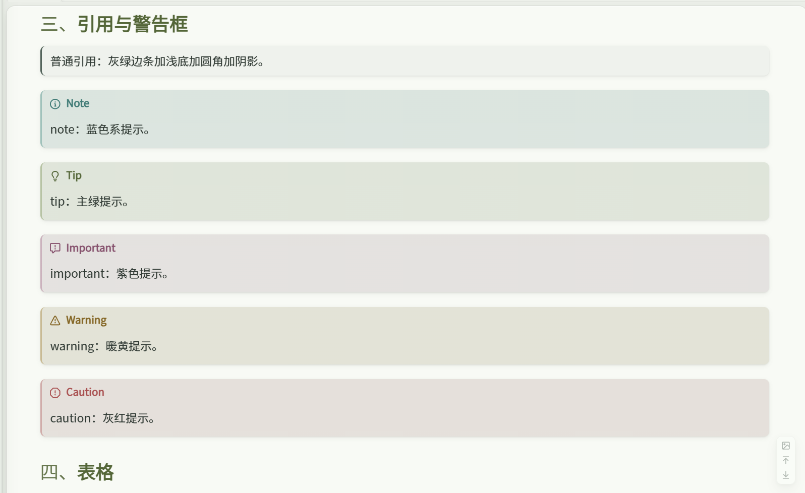

#### 代码块

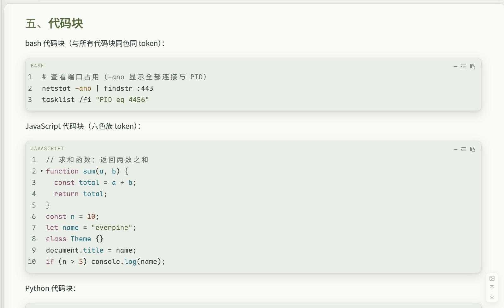

#### 偏好设置

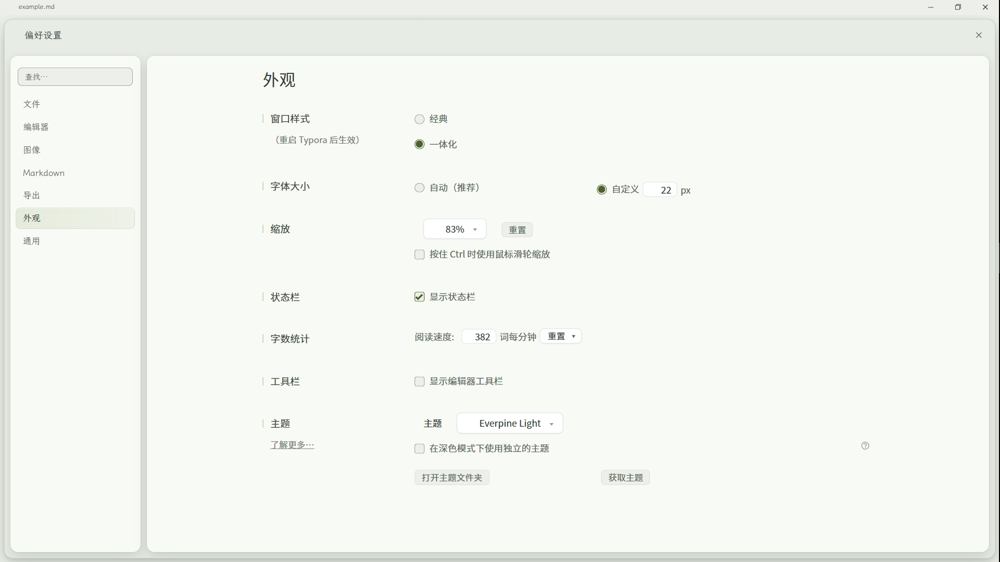

## 许可

本主题以 [MIT](LICENSE) 许可证发布。

三款内置字体的版权归各自作者所有，均以 SIL OFL 1.1 许可发布，可随主题自由分发；各字体的许可证全文随字体文件附在 `fonts` 目录：

| 字体 | 许可证文件 |
|:---|:---|
| Source Han Sans SC（思源黑体） | `fonts/LICENSE-SourceHanSansSC.txt` |
| Maple Mono NL NF Mono CN | `fonts/LICENSE-MapleMono.txt` |
| LXGW WenKai（霞鹜文楷） | `fonts/LICENSE-LXGWWenKai.txt` |
