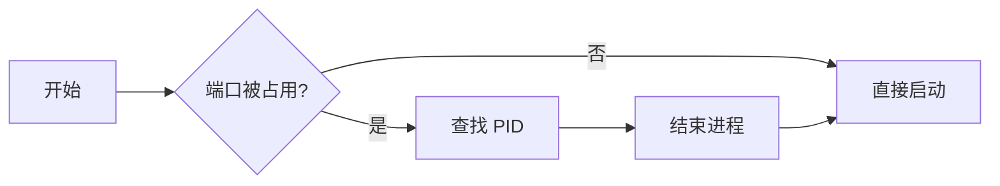

# 一级标题 h1（亮绿）

[TOC]


## 二级标题 h2（主绿 章级）

正文段落。**加粗暖黄**、*斜体不染色*、~~删除线弱化~~、`行内代码泡沫青chip`、[超链接绿色](https://typora.io)、<kbd>Ctrl</kbd>+<kbd>D</kbd> 键帽、==mark 高亮暖黄底==。

脚注引用 [^note]，长文本脚注 [^long]、含链接与代码的脚注 [^rich]、含公式的脚注 [^math]。


### 三级标题 h3（青）

#### 四级标题 h4（紫）

##### 五级标题 h5（橙）

###### 六级标题 h6（灰绿小标签）

## 列表

- 无序列表一级（青绿符号）
  - 无序列表二级（方块）
    - 无序列表三级（空心圆）
- 第二项：条目文字保持正文色，仅符号着色

1. 有序列表一级（橙符号）
2. 第二项
   1. 嵌套有序二级

- [ ] 任务列表未完成
- [x] 任务列表已完成（亮绿勾）

## 引用与警告框

> 普通引用：灰绿边条加浅底加圆角加阴影。

> [!NOTE]
> note：蓝色系提示。

> [!TIP]
> tip：主绿提示。

> [!IMPORTANT]
> important：紫色提示。

> [!WARNING]
> warning：暖黄提示。

> [!CAUTION]
> caution：灰红提示。


## 表格

蓝色系表头（表格专属色相，抬升亮一档底）：

| 命令 | 说明 | 端口 |
|:---|:---|:---:|
| `netstat -ano` | 查看连接与进程映射 | 445 |
| `route print` | 查看路由表 | -- |
| `netsh wlan show profiles` | 查看无线配置 | -- |
| `tasklist /svc` | 服务与进程对照 | -- |
| `wmic startup` | 查看开机启动项 | -- |
| `schtasks /query` | 列出计划任务 | -- |
| `netstat -anptu` | 查看 Linux 连接与进程映射 | 22 |
| `ss -tulnp` | 查看 Linux 监听端口 | -- |
| `systemctl list-units` | 列出运行中的服务 | -- |
| `netsh advfirewall show allprofiles` | 查看防火墙配置 | -- |
| `wmic process get name,processid` | 列出进程与 PID | -- |


## 代码块

JavaScript 代码块（六色族 token）：

```javascript
// 求和函数：返回两数之和
function sum(a, b) {
  const total = a + b;
  return total;
}
const n = 10;
let name = "everpine";
class Theme {}
document.title = name;
if (n > 5) console.log(name);
```

Mermaid 流程图（深色主题图表）：




bash 代码块（与所有代码块同色同 token）：

```bash
# 查看端口占用（-ano 显示全部连接与 PID）
netstat -ano | findstr :443
tasklist /fi "PID eq 4456"
```


超过十行的代码块（行号恒按两位预留宽度，跨过第十行不横跳）：

```javascript
const steps = [
  "unfold",
  "measure",
  "cut",
  "fold",
  "press",
  "trim",
  "check",
  "pack",
  "label",
  "ship",
  "track",
];
console.log(steps.length);
```

```html
<div class="md-alert">标签 <span>属性</span></div>
```

Python 代码块：

```python
def verify(path: str) -> bool:
    """校验文件编码是否为 UTF-8。"""
    with open(path, "rb") as f:
        raw = f.read()
    return raw.decode("utf-8") is not None

COUNT = 42
```

JSON 与 HTML：

```json
{"name": "everpine", "dark": true, "level": 3}
```

## 数学公式

行内公式 $E = mc^2$ 与块级公式：

$$\int_{0}^{1} x^2 \, dx = \frac{1}{3}$$

独行公式（点击进入编辑态可见源码卡与底部实时预览位）：

$$f(x) = \sum_{n=1}^{\infty} \frac{1}{n^2}$$

矩阵与行列式（验证大型结构的对齐与间距）：

$$A = \begin{pmatrix} a_{11} & a_{12} & \cdots & a_{1n} \\ a_{21} & a_{22} & \cdots & a_{2n} \\ \vdots & \vdots & \ddots & \vdots \\ a_{m1} & a_{m2} & \cdots & a_{mn} \end{pmatrix}$$

多行推导（aligned 环境，验证按等号对齐）：

$$\begin{aligned} \nabla \cdot \mathbf{E} &= \frac{\rho}{\varepsilon_0} \\ \nabla \cdot \mathbf{B} &= 0 \\ \nabla \times \mathbf{E} &= -\frac{\partial \mathbf{B}}{\partial t} \\ \nabla \times \mathbf{B} &= \mu_0 \mathbf{J} + \mu_0 \varepsilon_0 \frac{\partial \mathbf{E}}{\partial t} \end{aligned}$$


分段函数与极限：

$$g(x) = \begin{cases} \dfrac{\sin x}{x}, & x \neq 0 \\[2ex] 1, & x = 0 \end{cases} \qquad \lim_{n \to \infty} \left(1 + \frac{1}{n}\right)^n = e$$

含环积分与根式的行内混排：$\oint_{\partial S} \mathbf{F} \cdot d\mathbf{l} = \iint_{S} (\nabla \times \mathbf{F}) \cdot d\mathbf{S}$，以及 $\sqrt[n]{\dfrac{a^2 + b^2}{c^2}} \leqslant \dfrac{a + b}{c}$。

## 图片边界（纯白 纯黑 同底色）


## 分隔线与脚注

分隔线的常见用法有两类：一类在正文中分隔两个不设标题的话题块；另一类放在文末，把正文与脚注定义区隔开。

正文内分隔示例，两条分隔线之间的内容是一个独立话题块，前后各一条线把它与上下文隔开：

---

此处是一个独立话题块：提示、备注或与上下文衔接不紧密的内容都可以这样放置。分隔线在这里的作用是划出临时边界，不改变文档的标题层级。

---

文末分隔示例，最后一条分隔线之后的区域属于脚注定义列表：分隔线以上是正文，以下是脚注，两者视觉层级分离，脚注区请勿书写正文。

---

这里是脚注的正文说明 [^note]，同一注释的第二次引用 [^note]。

[^note]: 脚注内容：验证脚注区与回链样式。
[^long]: 长文本脚注：这条脚注的文字足够长，用于验证悬停预览卡在最大宽度处换行的排版效果，纸面上的行距与留白以此为准，再补一段文字让它超过两行，观察换行后的边缘对齐。
[^rich]: 含富文本的脚注：验证 [外部链接](https://typora.io)、`行内代码` 、*斜体不染色*、~~删除线弱化~~、<kbd>Ctrl</kbd>+<kbd>D</kbd> 键帽、==mark 高亮暖黄底== 与 **加粗** 在悬停预览卡内的样式。
[^math]: 含公式的脚注：验证悬停预览卡内 $E = mc^2$ 的主题绿渲染。

