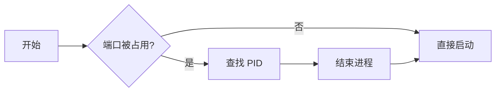

# 一级标题 h1（亮绿）

[TOC]

## 二级标题 h2（主绿 章级）

正文段落。**加粗暖黄**、*斜体不染色*、~~删除线弱化~~、`行内代码泡沫青chip`、[超链接绿色](https://typora.io)、<kbd>Ctrl</kbd>+<kbd>D</kbd> 键帽、==mark 高亮暖黄底==、脚注引用[^note]。

### 三级标题 h3（青）

#### 四级标题 h4（紫）

##### 五级标题 h5（橙）

###### 六级标题 h6（灰绿小标签）

## 列表

- 无序列表一级（青绿符号）
  - 无序列表二级（方块）
    - 无序列表三级（空心圆）
- 第二项：条目文字保持正文色，仅符号着色

1. 有序列表一级（橙符号）
2. 第二项
   1. 嵌套有序二级

- [ ] 任务列表未完成
- [x] 任务列表已完成（亮绿勾）

## 引用与警告框

> 普通引用：灰绿边条加浅底加圆角加阴影。

> [!NOTE]
> note：蓝色系提示。

> [!TIP]
> tip：主绿提示。

> [!IMPORTANT]
> important：紫色提示。

> [!WARNING]
> warning：暖黄提示。

> [!CAUTION]
> caution：灰红提示。

## 表格

蓝色系表头（表格专属色相，抬升亮一档底）：

| 命令 | 说明 | 端口 |
|:---|:---|:---:|
| `netstat -ano` | 查看连接与进程映射 | 445 |
| `route print` | 查看路由表 | -- |
| `netsh wlan show profiles` | 查看无线配置 | -- |
| `tasklist /svc` | 服务与进程对照 | -- |
| `wmic startup` | 查看开机启动项 | -- |
| `schtasks /query` | 列出计划任务 | -- |

## 代码块

bash 代码块（与所有代码块同色同 token）：

```bash
# 查看端口占用（-ano 显示全部连接与 PID）
netstat -ano | findstr :443
tasklist /fi "PID eq 4456"
```

JavaScript 代码块（六色族 token）：

```javascript
// 求和函数：返回两数之和
function sum(a, b) {
  const total = a + b;
  return total;
}
const n = 10;
let name = "everpine";
class Theme {}
document.title = name;
if (n > 5) console.log(name);
```

Python 代码块：

```python
def verify(path: str) -> bool:
    """校验文件编码是否为 UTF-8。"""
    with open(path, "rb") as f:
        raw = f.read()
    return raw.decode("utf-8") is not None

COUNT = 42
```

JSON 与 HTML：

```json
{"name": "everpine", "dark": true, "level": 3}
```

```html
<div class="md-alert">标签 <span>属性</span></div>
```

Mermaid 流程图（深色主题图表）：



## 数学公式

行内公式 $E = mc^2$ 与块级公式：

$$\int_{0}^{1} x^2 \, dx = \frac{1}{3}$$

## 图片边界（纯白 纯黑 同底色）


## 分隔线与脚注

---

这里是脚注的正文说明[^note]。

[^note]: 脚注内容：验证脚注区与回链样式。

